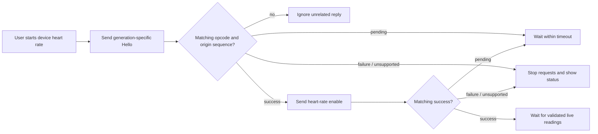

# Experimental device live-heart-rate integration

The app subscribes to selected custom WHOOP notifications and passively decodes frames before exposing readings. A separate decoder is kept for each characteristic stream. Only validated frame lengths, header CRC and payload CRC permit a decoded payload; raw timestamp components are not converted into a guessed epoch.

MAVERICK and GOOSE share service UUIDs. Their frame layouts were independently established by REA. The iPhone adapter selects the shared new-family wire layout; it does not identify a particular device generation from that UUID.

## Explicit request flow

The **Start device heart rate** button is available only after all three selected notification channels report ready and a command-write characteristic exists. The button begins a narrow experimental exchange:

`WhoopLiveSession` starts sequence allocation at zero and wraps byte255 to zero, matching the recovered counter operation. A retry uses the next sequence, so a stale previous acknowledgement does not immediately advance it. Sequence space is finite and is not an authentication mechanism. Duplicate replies do not cause duplicate writes. Pending replies do not advance the state. Each request has a ten-second local timeout; there are no automatic retries. Write errors and loss of required notifications abort a pending request. The iPhone uses a response-bearing GATT write when supported; otherwise it checks readiness before a response-free write.

The payloads are the recovered aligned forms:

- GEN4 Hello: `23 SS 23 00`.
- New-family Hello: `23 SS 91 01`.
- Realtime heart-rate enable: `23 SS 03 01`.

The encoder additionally exposes the recovered reversible disable request for independent reference tests, but the UI does not claim complete source cleanup behavior. Disconnecting ends this app's local subscription; the device's global stream-state lifetime is unverified.

## Deliberate boundaries

A success acknowledgement does not verify Hello identity/signature metadata or complete the official app's clock, firmware, device-name, bond-recovery and initialization logic. An inspected private Android gate can suppress stream toggles; its producer remains unresolved. The iPhone opt-in ordering is a local policy, not a demonstrated equivalent of the full Android workflow. No history, firmware-update, reset, clock-write or private-server request is sent by this integration.

No physical strap commands were executed during development. `WhoopCommandTests`, `WhoopFrameTests` and `WhoopLiveSessionTests` validate synthetic golden bytes, decoding, reply correlation and state transitions. They cannot establish radio interoperability, firmware compatibility or end-to-end device success.

The full evidence is in the accompanying analysis bundle: `phase5/HELLO-STREAM.md`, `HELLO-EVIDENCE-INDEX.json`, `PROTOCOL-OUTGOING.md` and `PROTOCOL-EVIDENCE-INDEX.json`. The exact selected frame and field identities are summarized in [WHOOP-PROTOCOL.md](WHOOP-PROTOCOL.md).
